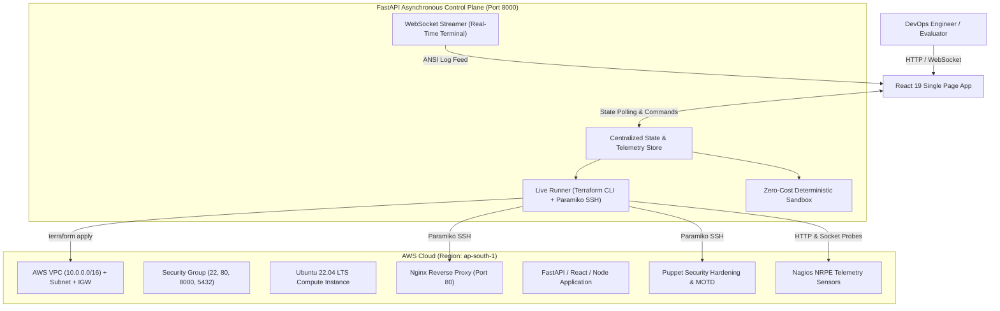

# CloudOps Studio &bull; Technical Presentation & Demo Script

> **A Complete Presenter's Handbook for Technical Demos, College Viva, Job Interviews, and Architectural Reviews.**

---

## 📌 Table of Contents
1. [Presentation Strategy & Timing](#1-presentation-strategy--timing)
2. [Phase 1: The Introduction & Hook (The "What")](#2-phase-1-the-introduction--hook-the-what)
3. [Phase 2: The Industry Problem (The "Why")](#3-phase-2-the-industry-problem-the-why)
4. [Phase 3: System Architecture & Design Philosophy](#4-phase-3-system-architecture--design-philosophy)
5. [Phase 4: Section-by-Section Walkthrough & Live Demo Script](#5-phase-4-section-by-section-walkthrough--live-demo-script)
   - [Top Navigation & Control Plane](#top-navigation--control-plane)
   - [Step 0: Pre-Flight Readiness Checklist](#step-0-pre-flight-readiness-checklist)
   - [Step 1: Terraform Infrastructure as Code (IaC)](#step-1-terraform-infrastructure-as-code-iac)
   - [Step 2: Ansible Application Stack Deployment](#step-2-ansible-application-stack-deployment)
   - [Step 3: Puppet Security & Compliance Baseline](#step-3-puppet-security--compliance-baseline)
   - [Step 4: Nagios Telemetry & Continuous Observability](#step-4-nagios-telemetry--continuous-observability)
   - [Interactive Chaos Engineering Lab](#interactive-chaos-engineering-lab)
   - [Real-Time Streaming Terminal](#real-time-streaming-terminal)
6. [Phase 5: Key Architectural Highlights & Engineering Decisions](#6-phase-5-key-architectural-highlights--engineering-decisions)
7. [Phase 6: Anticipated Tough Questions & Winning Answers (Q&A Cheat Sheet)](#7-phase-6-anticipated-tough-questions--winning-answers-qa-cheat-sheet)
8. [Phase 7: Delivery Tips & Closing Formula](#8-phase-7-delivery-tips--closing-formula)

---

## 1. Presentation Strategy & Timing

Choose your track based on the time allotted by your evaluators or interviewers:

| Track | Target Duration | Focus Area | Recommended Flow |
| :--- | :--- | :--- | :--- |
| **Lightning Pitch** | **3 – 5 Minutes** | High-level problem, live pipeline run, Chaos demo. | Intro (45s) &rarr; Run Pipeline (2m) &rarr; Chaos & Heal (1.5m) &rarr; Conclusion (30s) |
| **Standard Interview / Viva** | **10 – 15 Minutes** | Problem context, architecture, each tool's responsibility, live AWS verification. | Problem & Intro (3m) &rarr; Step-by-Step Demo (8m) &rarr; Architecture & Q&A (4m) |
| **Deep-Dive Tech Review** | **20 – 30 Minutes** | Code structure, security hardening, state management, chaos resilience, telemetry. | Full presentation with deep code walkthrough and design trade-offs. |

---

## 2. Phase 1: The Introduction & Hook (The "What")

### The 30-Second Elevator Pitch
> *"Good morning/afternoon everyone. Today, I am excited to present **CloudOps Studio** — an enterprise-grade, end-to-end DevOps automation, infrastructure orchestration, and observability platform.*
>
> *Instead of treating DevOps tools as disconnected scripts, CloudOps Studio provides a unified, interactive control plane that binds together the entire lifecycle: **Terraform** for cloud infrastructure, **Ansible** for application provisioning, **Puppet** for security policy compliance, and **Nagios Core** for active telemetry and auto-remediation — all backed by a high-performance **FastAPI asynchronous engine** and a modern **React 19 console**."*

### Why It Stands Out Immediately
1. **Dual Execution Engine**: Operates in **Live AWS Mode** (real EC2, VPC, SSH key pairs, remote Paramiko execution) and **Simulation Mode** (zero cloud cost sandbox for offline demonstrations).
2. **Unified Lifecycle**: Solves the disconnect between provisioning, configuration, compliance, and monitoring.
3. **Resilience Engineering**: Includes an integrated **Chaos Lab** where you don't just hope the infrastructure works — you inject faults and prove it self-heals in real time.

---

## 3. Phase 2: The Industry Problem (The "Why")

Presenters often jump straight into code. **Win your evaluators first by defining the real pain points in modern cloud engineering:**

```
The 4 Pain Points of Modern DevOps:
┌───────────────────────────┐     ┌───────────────────────────┐
│     1. Tool Sprawl        │     │  2. Configuration Drift   │
│  Terraform, Ansible, etc. │     │ Servers change over time; │
│  run in disconnected silos│     │ manual tweaks break prod  │
└─────────────┬─────────────┘     └─────────────┬─────────────┘
              │                                 │
              ▼                                 ▼
┌───────────────────────────┐     ┌───────────────────────────┐
│   3. Observability Gap    │     │ 4. Cloud Cost & Sandbox   │
│  Deployments finish with  │     │ Juniors lack safe testing │
│  no instant health probe  │     │ environments without bills│
└───────────────────────────┘     └───────────────────────────┘
```

### Exact Script to Speak:
1. **The Disconnected Silo Problem**:
   *"In many organizations, Terraform is run by one engineer, Ansible scripts are maintained in another repo, security baselines are checked manually on spreadsheets, and monitoring alerts come in after production goes down. There is no unified feedback loop."*
2. **The Configuration Drift Problem**:
   *"After an application is deployed, servers experience 'drift' — someone SSHs in, edits a config file, disables a firewall rule, and suddenly staging doesn't match production."*
3. **The Observability Gap**:
   *"A deployment script that exits with code 0 doesn't mean the service is healthy. We need continuous ICMP, HTTP, and socket-level telemetry immediately after provisioning."*
4. **Cloud Cost & Experimentation Barriers**:
   *"Learning and experimenting with production-grade AWS multi-tier setups is expensive and risky for students and developers. CloudOps Studio bridges this by providing a zero-cost deterministic simulator alongside real live AWS execution."*

---

## 4. Phase 3: System Architecture & Design Philosophy

Explain the high-level architecture with clarity and conviction:



### The 4 Pillars of Separation of Concerns:
- **Terraform** &rarr; *Immutable Cloud Infrastructure* (VPC, Security Groups, Key Pairs, EC2 instances).
- **Ansible** &rarr; *Application Delivery & Service Provisioning* (Nginx reverse proxy, systemd daemons, database engines).
- **Puppet** &rarr; *Security Governance & Policy Enforcement* (SSH hardening, fail2ban, UFW, zero-drift verification).
- **Nagios** &rarr; *Active Observability & Auto-Remediation* (Sub-second health probes, telemetry history, healing triggers).

---

## 5. Phase 4: Section-by-Section Walkthrough & Live Demo Script

Here is your exact playbook during a live screen share or presentation.

---

### Top Navigation & Control Plane

#### What It Does:
The top header serves as the mission control bar:
- **Live AWS vs. Simulation Mode Switch**: Switches the execution engine in real time.
- **AWS Region Selector**: Supports `ap-south-1` (Mumbai), `us-east-1` (N. Virginia), `eu-west-1` (Ireland), etc., and stays 100% synchronized with Terraform variables.
- **Public IP & Port 80 Pill**: Shows the live EC2 IP address (`http://13.201.34.154`) with an explicit `HTTP :80` badge and tooltip to avoid HTTPS redirect confusion.
- **Dark/Light Theme Toggle**: Full NOC dark room theme vs high-contrast light theme.
- **+ New Project Button**: Archives active deployments and resets the workspace cleanly.

#### What to Say:
> *"Notice the top control bar. In one click, I can toggle between **Simulation Mode** for zero-cost sandbox demos and **Live Mode** which talks directly to AWS. The region dropdown dynamically configures our Terraform provider. Notice the live IP badge with the explicit `HTTP :80` indicator — this tells any observer exactly how traffic routes into our EC2 instance."*

---

### Step 0: Pre-Flight Readiness Checklist

#### What It Does:
Validates the project's architectural requirements **before** spinning up cloud resources:
- Manifest presence (`package.json`, `requirements.txt`).
- Correct host binding (`0.0.0.0` instead of `localhost` or `127.0.0.1` so reverse proxies can forward traffic).
- Exclusion of bloat folders (`.venv/`, `node_modules/`).
- Port availability (80 for Web, 8000 for API, 5432 for DB).

#### What to Say:
> *"In production DevOps, over 60% of provisioning failures happen because an engineer bound an API to `localhost` instead of `0.0.0.0`, or pushed a 500MB `node_modules` folder to the cloud. Step 0 is our **Pre-Flight Gate**. It inspects the application stack requirements before we invoke cloud providers, saving time and compute costs."*

---

### Step 1: Terraform Infrastructure as Code (IaC)

#### What It Does:
Automates infrastructure provisioning on AWS:
- Creates a dedicated VPC (`10.0.0.0/16`) and Public Subnet (`10.0.1.0/24`).
- Provisions an Internet Gateway (IGW) and Route Tables for inbound/outbound connectivity.
- Generates an ephemeral 4096-bit RSA SSH Key Pair (`devops-key.pem`) saved locally with secure permissions (`0600`).
- Creates an AWS Security Group opening ports 22 (SSH), 80 (HTTP Web), 8000 (Backend API), and 5432 (PostgreSQL).
- Launches an **Ubuntu 22.04 LTS** EC2 instance (`t3.micro` for AWS Free Tier eligibility).

#### What to Say:
> *"Here in Step 1, Terraform acts as our cloud builder. When I click 'Provision Infrastructure', it executes `terraform apply -auto-approve`. Notice the live terminal streaming each resource creation event via WebSockets. Within seconds, AWS assigns a real public IPv4 address and DNS hostname, which immediately populates throughout our dashboard."*

#### Live Action to Show:
- Point out the **Instance ID** (`i-0999b1eaafcdf1efd`), **Region** (`ap-south-1`), and **Public IP** (`13.201.34.154`).
- Highlight the **One-Click SSH Command**: `ssh -i terraform/devops-key.pem ubuntu@<IP>`.

---

### Step 2: Ansible Application Stack Deployment

#### What It Does:
Takes the raw bare-metal Ubuntu instance and turns it into a functional multi-tier production environment:
- Installs and configures **Nginx** as a reverse proxy listening on Port 80.
- Configures the 3-Tier application stack based on user selection:
  - **Frontend UI**: React SPA or Static HTML5.
  - **Backend API**: Python FastAPI, Node.js Express, Java Spring Boot, or Universal Docker.
  - **Database Tier**: PostgreSQL 15, MySQL 8, MongoDB, or SQLite.
- Creates **Systemd service daemons** for automatic background process supervision and auto-restart on reboot.
- Includes a live built-in HTML code editor with instant preview.

#### What to Say:
> *"Now that the machine exists, Ansible takes over configuration management. Unlike bash scripts, Ansible is **idempotent** — running it once or ten times produces the exact desired state. It configures Nginx, routes traffic from Port 80 to our application tier, sets up Systemd daemons, and verifies with an HTTP 200 health check.
>
> If I click **Open Live Site** right now, it takes us directly to the running application on our live EC2 server."*

#### Live Action to Show:
- Click the **Live View** button or open `http://13.201.34.154/` in a new tab. Show the audience that the deployed web application responds instantly with HTTP 200 OK.

---

### Step 3: Puppet Security & Compliance Baseline

#### What It Does:
Applies enterprise security governance to prevent configuration drift:
- **SSH Hardening**: Disables password authentication, disables direct root login (`PermitRootLogin no`), and limits authentication attempts (`MaxAuthTries 4`).
- **Firewall & Security Packages**: Automatically deploys and enables `ufw` (Uncomplicated Firewall) and `fail2ban` for automated brute-force protection.
- **Enterprise MOTD Banner**: Places an authoritative compliance banner in `/etc/motd`.
- **Zero-Drift Policy Check**: Continuously audits system state against the desired baseline.

#### What to Say:
> *"A frequent interview question is: 'Why use both Ansible and Puppet?'
> Ansible is fantastic for **orchestration and application deployment** — doing steps A, B, and C in order. But Puppet's superpower is **declarative policy enforcement and drift management**. 
>
> In Step 3, Puppet enforces our security baseline: it locks down SSH, sets up fail2ban to mitigate brute-force attacks, enables firewall policies, and reports zero configuration drift."*

---

### Step 4: Nagios Telemetry & Continuous Observability

#### What It Does:
Provides continuous, active telemetry without third-party heavy agents:
- Real-time **Health Score** (0% to 100%).
- Multi-tier active probes:
  - **Host Ping (Network)**: ICMP latency and packet loss.
  - **Web Tier (Port 80)**: HTTP status code (200 OK) and response time in milliseconds.
  - **SSH Daemon (Port 22)**: TCP socket verification.
  - **Resource Telemetry**: Real-time CPU utilization, RAM usage, and Disk capacity.
- 20-point historical telemetry graph plotting latency and resource consumption over time.

#### What to Say:
> *"A deployment is incomplete without observability. Step 4 runs our Nagios monitoring engine. A background poller queries the server every few seconds, tracking network latency, web server response times, and system metrics like CPU, RAM, and disk utilization. You can see our live response time is sitting at ~75ms with 100% health."*

---

### Interactive Chaos Engineering Lab

#### What It Does:
Allows intentional injection of realistic production outages:
- **Fault 1: Nginx Crash** (`killall -9 nginx` &rarr; Port 80 stops responding).
- **Fault 2: CPU Spike** (`stress-ng` or busy loop &rarr; CPU utilization hits 100%).
- **Fault 3: Memory Exhaustion** (Simulates a memory leak).
- **Fault 4: Security Drift** (Simulates unauthorized tampering with SSH or firewall configs).
- **Automated Self-Healing**: Automatically invokes remediation playbooks to restore failed services to full health.

#### What to Say:
> *"In production, things break. Netflix pioneered Chaos Engineering with Chaos Monkey to prove their systems could survive failure.
>
> Let's test CloudOps Studio's resilience. I will deliberately inject an **Nginx Crash**. Watch Nagios in real time: within seconds, the Web Tier alert turns **CRITICAL** (Red), the overall health score drops, and an incident is logged.
>
> Now, I click **Auto-Heal System**. The orchestrator dispatches an Ansible self-healing task, restarts the service, and verifies the HTTP 200 response. The health score rebounds to 100%."*

#### Live Action to Show:
1. Click **Nginx Crash** in Chaos Lab.
2. Watch the telemetry card turn RED (`CRITICAL - Port 80 Connection Refused`).
3. Click **Auto-Heal System**.
4. Watch the status recover back to GREEN (`OK - 200 OK`). Evaluators love this demonstration!

---

### Real-Time Streaming Terminal

#### What It Does:
- Asynchronous WebSocket-driven log stream running directly from the server.
- ANSI color formatting for errors, warnings, and success notices.
- Stage-specific filtering tabs (`ALL`, `TERRAFORM`, `ANSIBLE`, `PUPPET`, `NAGIOS`, `CHAOS`).
- One-click **Copy Logs** button for post-incident audits.

#### What to Say:
> *"Transparency is essential in DevOps. Rather than hiding execution behind simple spinners, our streaming terminal exposes real-time stdout and stderr streams directly from the operating system, allowing operators to audit every command."*

---

## 6. Phase 5: Key Architectural Highlights & Engineering Decisions

When asked about the code and design choices, emphasize these technical pillars:

1. **Why FastAPI for the Backend?**
   - High concurrency using Python's `asyncio` event loop.
   - Native WebSocket support for streaming live terminal output to multiple clients simultaneously with zero blocking.
   - Pydantic models for strict type safety and automatic input validation.

2. **Why React 19 + Vite?**
   - Blazing-fast sub-second build times.
   - Modular component hierarchy: clean separation of steps, modals, and telemetry graphs.
   - Accessible, responsive layout tested from mobile displays up to widescreen NOC monitors.

3. **Security by Design**:
   - Dynamic 4096-bit RSA keys generated per environment — no hardcoded AWS credentials or private keys in Git.
   - Sensitive cloud credentials stored locally in protected configuration files (`.credentials.json`), kept outside Git via `.gitignore`.
   - Security groups follow the principle of least privilege, exposing only the exact ports needed.

4. **Production Hygiene & Minimalism**:
   - Zero unnecessary dependencies or dead assets.
   - All background jobs supervised under Systemd with automatic failure restarts.

---

## 7. Phase 6: Anticipated Tough Questions & Winning Answers (Q&A Cheat Sheet)

Be prepared for these common interviewer/examiner questions:

### Q1: "Why did you use both Ansible and Puppet in the same project? Aren't they competitors?"
> **Winning Answer:**
> *"While both are configuration tools, they excel at different paradigms. **Ansible is procedural, push-based, and agentless**, which makes it ideal for step-by-step orchestration — like installing Nginx, pulling code, and starting application services in a precise sequence.
>
> **Puppet is declarative, pull-based, and state-driven**, making it the gold standard for continuous compliance and security governance. We use Puppet to enforce security baselines (SSH settings, firewall rules, fail2ban) and continuously prevent configuration drift without interfering with application deployments."*

### Q2: "How does your platform handle cloud costs if someone forgets to destroy resources?"
> **Winning Answer:**
> *"First, our default Terraform configuration uses `t3.micro` instances, which fall squarely within the AWS Free Tier. Second, the platform provides a **One-Click Destroy Infrastructure** action that executes `terraform destroy -auto-approve` to completely deprovision the VPC, subnet, gateway, and EC2 instance. Third, for testing and offline scenarios, our **Simulation Mode** allows full end-to-end demonstrations with zero AWS cloud costs."*

### Q3: "What happens if a Terraform provisioning step fails halfway through?"
> **Winning Answer:**
> *"Terraform uses a persistent state file (`terraform.tfstate`). If a step fails, Terraform records the state of resources successfully created. Our FastAPI backend catches the non-zero exit code, streams the exact error to the terminal, and flags the step as failed. The operator can inspect the logs, correct the configuration (such as AWS credentials or quota limits), and re-run. Terraform will idempotently pick up where it left off without duplicating resources."*

### Q4: "How does the live terminal achieve zero-latency log streaming without freezing the UI?"
> **Winning Answer:**
> *"The FastAPI backend reads subprocess stdout and stderr streams asynchronously using `asyncio.subprocess` and yields lines over a dedicated WebSocket connection. On the frontend, logs are batched into a ring buffer in React state using `requestAnimationFrame`, preventing DOM reflow thrashing even during high-volume log bursts."*

### Q5: "How does the self-healing in your Chaos Lab work?"
> **Winning Answer:**
> *"When a fault like an Nginx crash is injected, the Nagios telemetry worker immediately notices the failed TCP handshake on Port 80 and transitions the health state to CRITICAL. When the user or automated supervisor clicks 'Auto-Heal', the orchestrator triggers a targeted remediation Ansible task that inspects service status, repairs any corrupted configuration files, restarts the Systemd unit, and validates with an HTTP 200 probe."*

---

## 8. Phase 7: Delivery Tips & Closing Formula

### Presentation Dos and Don'ts:
- &check; **DO keep AWS EC2 already provisioned** before the presentation starts if internet connectivity might be slow. This allows you to demo Step 2 &rarr; Step 3 &rarr; Step 4 &rarr; Chaos immediately!
- &check; **DO open the live public IP in a separate browser tab** beforehand (`http://<ip>/`) so you can switch tabs to prove it is live.
- &check; **DO mention both Live and Simulation modes** — it shows commercial maturity and cost-consciousness.
- &cross; **DON'T read long blocks of text** from the screen. Point to visual cards, metric badges, and terminal logs.
- &cross; **DON'T panic if network latency causes a probe delay**. Explain: *"Notice Nagios accommodates network jitter with standard retry thresholds, exactly like in a production NOC."*

### The Strong Closing Statement:
> *"To summarize: CloudOps Studio demonstrates that modern DevOps is not about juggling separate CLI tools. By unifying Infrastructure as Code, Configuration Management, Policy Compliance, and Active Observability into a single cohesive control plane, we achieve faster deployments, automated governance, and demonstrable system resilience.
>
> Thank you for your time, and I am now happy to take any questions."*

---

*Authored for the CloudOps Studio Project &bull; Ready for Evaluation, Interviews, and Public Demonstration.*
