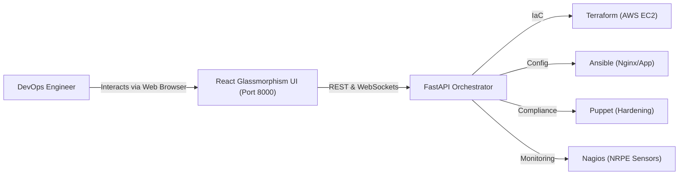

# CloudOps Studio &bull; Automated Cloud Infrastructure & Configuration Management Platform

[](https://aws.amazon.com/)
[](https://terraform.io/)
[](https://ansible.com/)
[](https://puppet.com/)
[](https://nagios.org/)

An enterprise-grade, end-to-end DevOps automation platform designed for university class projects, capstone demonstrations, and portfolio presentations. The platform automatically creates cloud servers, configures them, deploys a web application, enforces configuration compliance, and monitors server health with real-time incident detection and auto-remediation — all accessible via a sleek, interactive **Web Control Center**.

---

## 🌟 Key Features

* **1. Cloud Provisioning via Terraform (IaC)**:
  * Declaratively creates AWS VPC, Subnet, Internet Gateway, and customized Security Groups (Ports 22, 80, 443, 5666).
  * Automatically provisions Ubuntu 22.04 LTS EC2 instances with 4096-bit RSA SSH key pairs.
  * Outputs live connection telemetry (Instance ID, Public IP, DNS, SSH strings).

* **2. Web Server & Application Deployment via Ansible**:
  * Idempotent playbooks to install and configure **Nginx** (or **Apache HTTP Server**).
  * Deploys a high-tech, responsive **Cloud Operations Portal** static web application to `/var/www/devops_app`.
  * Verifies live HTTP 200 responses before concluding.

* **3. Configuration Drift & Compliance via Puppet**:
  * Enforces security baselines: SSH daemon hardening (`MaxAuthTries 4`, `X11Forwarding no`, `ClientAliveInterval 300`).
  * Enforces compliance MOTD & banner, required system packages (`fail2ban`, `ufw`, `htop`).
  * **Self-Healing Anti-Drift**: Detects unauthorized configuration tampering and reconciles the server back to desired state.

* **4. Health & Service Monitoring via Nagios Core & NRPE**:
  * Real-time telemetry: Host Ping, HTTP status on Port 80, SSH daemon status on Port 22, CPU utilization, RAM usage, and Disk consumption.
  * Warning and Critical threshold alerts with incident tracking.

* **5. Dual Execution Engine (Live AWS & Interactive Simulator)**:
  * **Live Mode**: Executes real Terraform CLI, connects over SSH via Paramiko, runs Ansible playbooks and Puppet manifests on AWS EC2.
  * **Simulation Mode**: Fail-safe offline demonstration mode with realistic streaming logs, dynamic telemetry fluctuations, and instant zero-cost demoing.

* **6. Chaos Engineering & Self-Healing Lab**:
  * Test service outages ("Simulate Web Crash", "Simulate CPU Spike", "Simulate Config Drift").
  * Watch Nagios instantly detect failures and trigger red critical alarms.
  * Click "Auto-Remediate" to watch Puppet and Ansible restore the system to green healthy status.

* **7. Real-Time Streaming DevOps Terminal**:
  * Black terminal window streaming logs live over WebSockets with ANSI stage badges and auto-scroll.

---

## 🏗️ System Architecture



---

## 🚀 Quick Start Guide

### 1. Requirements
* Python 3.10+
* Node.js 18+ (already bundled / built in `client/dist`)
* Windows, Linux, macOS, or WSL

### 2. Launch the Platform (One-Click)

#### On Windows:
Double-click `start.bat` or run in PowerShell:
```cmd
start.bat
```

#### On Linux / macOS / WSL:
```bash
chmod +x start.sh
./start.sh
```

The platform will automatically launch in your browser at:
👉 **`http://127.0.0.1:8000`**

---

## 📁 Repository Directory Structure

```
Devops331/
├── terraform/                      # Infrastructure as Code
│   ├── main.tf                     # EC2, Security Group (22, 80, 443, 5666), Key Pairs
│   ├── variables.tf                # AWS region, instance_type, ami
│   ├── outputs.tf                  # Public IP, instance_id, app_url
│   └── terraform.tfvars.example    # Configuration example
├── ansible/                        # Configuration & Deployment
│   ├── site.yml                    # Master deployment playbook
│   ├── ansible.cfg                 # Ansible SSH & callback configuration
│   ├── inventory.ini.template      # Dynamic inventory template
│   └── roles/
│       ├── nginx/                  # Nginx setup & virtual host templates
│       ├── apache/                 # Apache setup & virtual host templates
│       └── webapp/                 # Responsive CloudOps web application
├── puppet/                         # Compliance & Drift Enforcement
│   └── manifests/
│       └── site.pp                 # Hardening, MOTD banner, NRPE prerequisites
├── nagios/                         # Monitoring & Alerting
│   ├── objects/
│   │   ├── commands.cfg            # Nagios check command definitions
│   │   └── devops_server.cfg       # Host & service definitions
│   └── alerts_catalog.json         # Thresholds and remediation rules
├── server/                         # FastAPI Python Backend
│   ├── app.py                      # REST & WebSocket server
│   ├── state.py                    # Thread-safe platform state store
│   ├── simulator.py                # Realistic demo simulation engine
│   ├── live_runner.py              # AWS Terraform & SSH runner
│   └── requirements.txt            # Python dependencies
├── client/                         # Modern React + Vite Frontend
│   ├── src/
│   │   ├── components/             # Steppers, TopStats, Terminal, Modals, Chaos
│   │   ├── services/api.ts         # Axios & WebSocket client
│   │   ├── App.tsx                 # Master layout & interaction logic
│   │   └── index.css               # Modern glassmorphism theme
│   ├── package.json
│   └── vite.config.ts
├── docs/                           # Academic Project Documentation
│   ├── ARCHITECTURE.md             # In-depth architectural blueprint
│   ├── VIVA_QA.md                  # 20+ viva questions & model answers
│   └── LAB_MANUAL.md               # 5-minute examiner demonstration walkthrough
├── start.bat                       # Windows one-click launcher
├── start.sh                        # Linux / Mac launcher
└── README.md                       # Main documentation
```

---

## 🎓 Academic Viva & Presentation Materials

* **Architecture Deep-Dive**: Consult [`docs/ARCHITECTURE.md`](docs/ARCHITECTURE.md) for full data flows and diagrams.
* **Viva Questions & Answers**: Consult [`docs/VIVA_QA.md`](docs/VIVA_QA.md) for 20+ common examination questions covering Terraform, Ansible, Puppet, and Nagios.
* **Demonstration Script**: Consult [`docs/LAB_MANUAL.md`](docs/LAB_MANUAL.md) for a structured step-by-step walkthrough to present to your professor.

