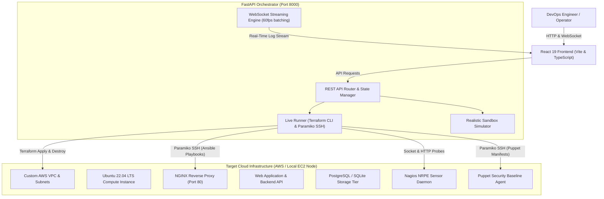

# CloudOps Studio &bull; Enterprise DevOps Automation & Cloud Orchestration Platform

[](https://aws.amazon.com/)
[](https://terraform.io/)
[](https://ansible.com/)
[](https://puppet.com/)
[](https://nagios.org/)
[](https://fastapi.tiangolo.com/)
[](https://react.dev/)

An enterprise-grade, end-to-end DevOps automation, infrastructure orchestration, and observability platform. Designed for production-grade cloud management, technical demonstrations, and enterprise DevOps operations, CloudOps Studio integrates the entire modern DevOps lifecycle into a cohesive, interactive control plane.

The platform orchestrates **Terraform** (Infrastructure as Code), **Ansible** (Application & Web Server Provisioning), **Puppet** (Security & Policy Enforcement), and **Nagios Core** (Telemetry & Health Probes) through an asynchronous **FastAPI Orchestrator** and a modern, responsive **React Web Console**.

---

## 🌟 Key Highlights & Capabilities

* **End-to-End Automated 4-Stage Pipeline**:
  * **0. Pre-Flight Readiness**: Manifest validation, host binding checks (`0.0.0.0`), port conflict detection, and file exclusion guards.
  * **1. Terraform IaC**: Provisions VPCs, Subnets, Internet Gateways, Security Groups, dynamic 4096-bit RSA keys, and Ubuntu 22.04 LTS EC2 instances (defaulting to AWS Free Tier `t3.micro`).
  * **2. Ansible Stack Deployment**: Idempotent configuration of Nginx/Apache reverse proxies, systemd daemons, and database tiers.
  * **3. Puppet Security Baseline**: Locks down SSH daemon (`MaxAuthTries 4`, root login disabled), enforces compliance MOTD, configures local firewall (`ufw`), and deploys security packages (`fail2ban`).
  * **4. Nagios Telemetry & Probes**: Real-time probes for ICMP ping, Web Tier (Port 80), Backend API (Port 8000), Database (Port 5432), SSH (Port 22), CPU, RAM, and disk utilization.

* **Dual Execution Engine (Live AWS & Simulation Mode)**:
  * **Live Mode**: Executes authentic Terraform CLI binary commands, establishes SSH sessions via Paramiko, executes Ansible playbooks, and runs live remote health probes on real AWS EC2 instances.
  * **Simulation Mode**: Instant, deterministic sandbox mode with realistic log streaming, dynamic telemetry curves, and zero AWS cloud costs for offline demonstrations.

* **Multi-Project Deployment & Archival**:
  * Click **+ New Project** to archive active cloud environments with full state history and immediately reset the wizard for new deployments.
  * Switch seamlessly between projects in the Project History drawer without losing state or configurations.

* **Polyglot & Custom Application Ingestion**:
  * Upload custom web application source code (React, Vue, HTML/CSS, Python FastAPI/Flask, Node.js Express, Java Spring Boot, Go, or Dockerized workloads) directly into Ansible roles.

* **Chaos Engineering & Auto-Remediation Lab**:
  * Inject deliberate service faults (Nginx Crash, CPU Spikes, Memory Leaks, Configuration Tampering).
  * Observe Nagios detect failures in real time and trigger automated multi-tier self-healing playbooks.

* **Developer Ergonomics & Modern UI/UX**:
  * **Two-Way AWS Region Synchronization**: Changing regions in the top navigation bar instantly syncs with Step 1 Terraform IaC, settings modals, and backend persistence.
  * **Dual NOC Themes**: Enterprise Dark (NOC control room) and High-Contrast Light theme toggleable from both top navbar and sidebar.
  * **Real-Time Streaming Terminal**: Live WebSocket log stream with ANSI coloring, auto-scroll protection, and stage filtering.

---

## 🏗️ System Architecture



---

## 📋 Pipeline Stages in Detail

| Step | Technology | Purpose | Output & Verification |
| :--- | :--- | :--- | :--- |
| **0** | **Pre-Flight Check** | Project structure & dependency validation | Verifies manifests (`package.json`, `requirements.txt`), 0.0.0.0 binding, excludes `.venv`/`node_modules` |
| **1** | **Terraform IaC** | Cloud infrastructure provisioning | VPC, Subnet, IGW, Security Groups, SSH Key Pair, EC2 Public IP address |
| **2** | **Ansible Deploy** | Web server & stack configuration | Nginx / Apache reverse proxy, systemd application daemon, HTTP 200 verification |
| **3** | **Puppet Baseline**| Configuration compliance & security hardening | Enforces SSH hardening, MOTD banner, firewall, fail2ban, zero-drift verification |
| **4** | **Nagios Telemetry**| Observability, telemetry & active probes | Health score (100% UP), ICMP latency, Port 80, Port 8000, CPU/RAM/Disk metrics |
| **Lab**| **Chaos Lab** | Resilience testing & auto-remediation | Fault injection (`kill_nginx`, `cpu_burn`), alert triggers, automated healing |

---

## 📁 Repository Directory Structure

```
Devops331/
├── client/                         # React 19 + TypeScript + Vite Web Console
│   ├── src/
│   │   ├── components/             # Steppers, ConsoleOverview, Terminal, Chaos, Modals
│   │   ├── services/api.ts         # Axios REST client & WebSocket streaming handler
│   │   ├── types.ts                # TypeScript domain models and state contracts
│   │   ├── App.tsx                 # Core UI orchestrator and lifecycle logic
│   │   └── index.css               # Design tokens, themes, and glassmorphism styling
│   ├── package.json
│   └── vite.config.ts
├── server/                         # FastAPI Python Orchestrator
│   ├── app.py                      # REST API endpoints & WebSocket log distributor
│   ├── state.py                    # Thread-safe in-memory state & project manager
│   ├── live_runner.py              # AWS Terraform CLI & Paramiko SSH live runner
│   ├── simulator.py                # Realistic mock engine for offline demonstrations
│   └── requirements.txt            # Python dependencies (FastAPI, uvicorn, paramiko, etc.)
├── terraform/                      # Infrastructure as Code
│   ├── main.tf                     # AWS VPC, Subnet, IGW, Security Groups, EC2 instance
│   ├── variables.tf                # Region, instance type (t3.micro), AMI mappings
│   ├── outputs.tf                  # Exported public IP, instance ID, and connection strings
│   └── terraform.tfvars.example    # Sample environment configuration
├── ansible/                        # Configuration & Deployment
│   ├── site.yml                    # Master deployment playbook
│   ├── ansible.cfg                 # Ansible SSH & callback configuration
│   ├── inventory.ini.template      # Dynamic inventory template populated by runner
│   └── roles/
│       ├── nginx/                  # Nginx reverse proxy configuration & vhosts
│       ├── apache/                 # Apache HTTP server alternative role
│       └── webapp/                 # Web application files & systemd service units
├── puppet/                         # Policy & Compliance Enforcement
│   └── manifests/
│       └── site.pp                 # SSH hardening, MOTD banners, firewall, fail2ban
├── nagios/                         # Health & Telemetry Probes
│   ├── objects/                    # Nagios host and service definitions
│   └── alerts_catalog.json         # Thresholds and remediation action mapping
├── tests/                          # Automated Pytest Test Suite
│   ├── conftest.py                 # Test fixtures and mock state
│   ├── test_pipeline_guardrails.py # Prerequisite and sequential order enforcement
│   ├── test_upload_security.py     # Size limits, path traversal blocks, file counters
│   ├── test_projects.py            # Project creation, switching, and archival
│   ├── test_config_security.py     # Credential masking and secret isolation
│   └── test_chaos_simulator.py     # Chaos injection and auto-healing verification
├── docs/                           # Academic & Technical Documentation
│   ├── ARCHITECTURE.md             # In-depth architectural specification
│   ├── VIVA_QA.md                  # Comprehensive viva questions and model answers
│   └── LAB_MANUAL.md               # 5-minute practical demonstration walkthrough
├── start.bat                       # One-click Windows launcher
├── start.sh                        # One-click Linux / macOS launcher
└── README.md                       # Main platform documentation
```

---

## 🚀 Quick Start Guide

### Prerequisites
* **Python**: 3.10 or higher
* **Node.js**: 18.0 or higher (frontend production build is pre-compiled in `client/dist`)
* **Operating System**: Windows, Linux, macOS, or WSL
* **Optional (Live Mode)**: AWS IAM Access Key & Secret Key with EC2 permissions (`AmazonEC2FullAccess`)

### 1. Launch Platform (One-Click)

#### Windows
Run from Command Prompt or PowerShell:
```cmd
start.bat
```

#### Linux / macOS / WSL
```bash
chmod +x start.sh
./start.sh
```

The orchestrator starts on **`http://127.0.0.1:8000`** and will automatically open in your default browser.

---

### 2. Manual Development Setup

If you wish to run backend and frontend separately for development:

#### Backend (FastAPI)
```bash
cd server
python -m venv .venv

# On Windows:
.venv\Scripts\activate
# On Linux/macOS:
source .venv/bin/activate

pip install -r requirements.txt
python -m uvicorn app:app --host 127.0.0.1 --port 8000 --reload
```

#### Frontend (React + Vite)
```bash
cd client
npm install
npm run dev
```

---

## 🛡️ Security & Architectural Guardrails

1. **Pipeline Prerequisite Enforcement**: Steps cannot be executed out of order (Ansible requires Terraform; Puppet requires Ansible; Nagios requires Puppet). Attempting out-of-order execution returns HTTP 400 with actionable feedback.
2. **Zero-Knowledge Credential Handling**: AWS Secret Access Keys are accepted over secure POST, stored in server-side memory, and immediately erased from the client React state. Server responses mask keys (`Vvc/...LWm/`).
3. **Upload Sandboxing**: Uploaded project payloads are strictly capped at 100 MB and 1,000 files maximum. Filenames and paths are sanitized against path traversal (`../`) attacks.
4. **Free-Tier Protection**: Default instance type is locked to `t3.micro` across all supported AWS regions (`ap-south-1`, `us-east-1`, `us-west-2`, `eu-west-1`) to prevent unintended AWS billing.
5. **Teardown Confirmation Guard**: Infrastructure destruction requires explicit user typing of `destroy` in a confirmation modal before triggering `terraform destroy`.

---

## 🧪 Testing & Verification

The platform includes full test suites for both backend and frontend:

```bash
# Run backend automated unit tests
pytest

# Run frontend linter (OxLint)
npm --prefix client run lint

# Build frontend production bundle
npm --prefix client run build
```

---

## 🎓 Academic Defense & Viva Q&A

Comprehensive exam preparation and demonstration guides are included in the [`docs/`](docs/) directory:

* **[Architecture Deep-Dive](docs/ARCHITECTURE.md)**: Network topology, security groups, data pipelines, and sequence diagrams.
* **[Viva & Examiner Q&A Guide](docs/VIVA_QA.md)**: 20+ commonly asked questions covering IaC, configuration idempotency, desired-state convergence, and monitoring thresholds.
* **[5-Minute Examiner Walkthrough](docs/LAB_MANUAL.md)**: Scripted walkthrough for technical evaluation and project demonstrations.

---

## 📄 License

This project is developed for educational and portfolio demonstration purposes under the **MIT License**.
