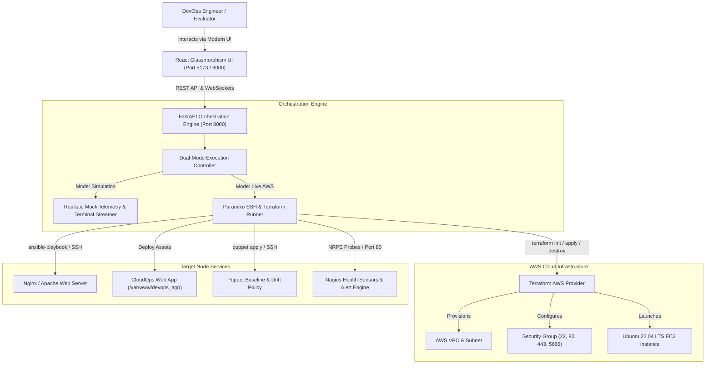

# System Architecture & Technical Specifications
## Automated Cloud Infrastructure & Configuration Management Platform

---

### 1. Introduction & Project Scope

In enterprise cloud computing, modern DevOps architectures follow the principle of **Separation of Concerns across Automation Layers**:
1. **Infrastructure Provisioning**: Declarative creation of cloud hardware, networks, and virtual compute (Terraform).
2. **Configuration & Application Deployment**: Automated installation of services and web application runtimes (Ansible).
3. **Configuration Drift Compliance & Self-Healing**: Enforcing desired system states and security baselines over time (Puppet).
4. **Availability & Performance Observability**: Active health probing, daemon status checking, and alert dispatching (Nagios).

This platform synthesizes all four pillars into a unified, interactive **Web Control Center**, allowing DevOps engineers, students, and evaluators to manage the entire lifecycle with real-time feedback.

---

### 2. Architectural Diagram

---

### 3. Detailed Component Breakdown

#### A. Terraform (Infrastructure as Code)
* **Configuration Path**: `terraform/main.tf`, `variables.tf`, `outputs.tf`
* **Role**: Automates the lifecycle of AWS cloud resources.
* **Resources Created**:
  * `aws_security_group`: Restricts inbound traffic strictly to required ports: Port 22 (SSH), Port 80 (HTTP), Port 443 (HTTPS), Port 5666 (Nagios NRPE).
  * `tls_private_key`: Generates an ephemeral 4096-bit RSA cryptographic key pair.
  * `aws_key_pair`: Registers the generated public key with AWS.
  * `aws_instance`: Launches an Ubuntu 22.04 LTS EC2 instance (`t2.micro` / `t3.micro`) with gp3 SSD storage.
  * `outputs.json`: Exports Public IP, DNS, and SSH connection string for downstream tools.

#### B. Ansible (Configuration Management & Deployment)
* **Configuration Path**: `ansible/site.yml`, `roles/nginx`, `roles/apache`, `roles/webapp`
* **Role**: Configures the server environment and deploys the application.
* **Key Tasks**:
  * Dynamic inventory templating based on Terraform output.
  * Idempotent installation of Nginx or Apache HTTP Server.
  * Virtual host setup and default site deactivation.
  * Deployment of responsive Cloud Operations Portal static assets to `/var/www/devops_app`.
  * Dynamic generation of `/var/www/devops_app/healthz.json` metadata for health monitoring.
  * Verification of HTTP status 200 before concluding playbook.

#### C. Puppet (Compliance & Drift Self-Healing)
* **Configuration Path**: `puppet/manifests/site.pp`
* **Role**: Continuous security compliance and anti-drift reconciliation.
* **Enforced Policies**:
  * **SSH Hardening**: Enforces `MaxAuthTries 4`, `X11Forwarding no`, and `ClientAliveInterval 300` in `/etc/ssh/sshd_config.d/99-hardened.conf`.
  * **Compliance Banner**: Enforces strict MOTD banner in `/etc/motd` and `/etc/issue.net`.
  * **File Integrity**: Guarantees `/var/www/devops_app` permissions (`0755` directory, owner `www-data`).
  * **Monitoring Prerequisites**: Automatically installs and configures `nagios-nrpe-server` and `monitoring-plugins`.
  * **Drift Healing**: If an administrator or attacker manually alters `/etc/motd` or disables SSH policies, running Puppet reconciles the files back to the approved manifest.

#### D. Nagios (Health Probing & Alerting)
* **Configuration Path**: `nagios/objects/commands.cfg`, `nagios/objects/devops_server.cfg`, `nagios/alerts_catalog.json`
* **Role**: Continuous observability, threshold evaluation, and alert dispatching.
* **Active Probes**:
  * **HTTP Check**: Validates that port 80 responds within 1500ms with HTTP 200 OK.
  * **SSH Check**: Validates that port 22 accepts TCP connections.
  * **CPU Check**: Evaluates load averages via NRPE (Warning > 75%, Critical > 90%).
  * **Memory Check**: Tracks RAM consumption (Warning > 80%, Critical > 92%).
  * **Disk Check**: Monitors root volume storage (Warning > 80%, Critical > 90%).

#### E. Chaos Engineering Simulation Lab
* A dedicated fault injection engine built into the UI allowing operators to test system resilience:
  * **Web Crash (`http_down`)**: Shuts down the web server daemon. Nagios immediately detects HTTP refusal and fires CRITICAL alarms.
  * **CPU Stress (`cpu_spike`)**: Spikes compute utilization past 90%, triggering Nagios `check_load` alerts.
  * **Configuration Drift (`config_tamper`)**: Alters system banners and security settings, triggering Puppet drift alerts.
  * **Auto-Heal Action**: Automatically invokes Puppet/Ansible remediation scripts to restore the system to full operational status.
